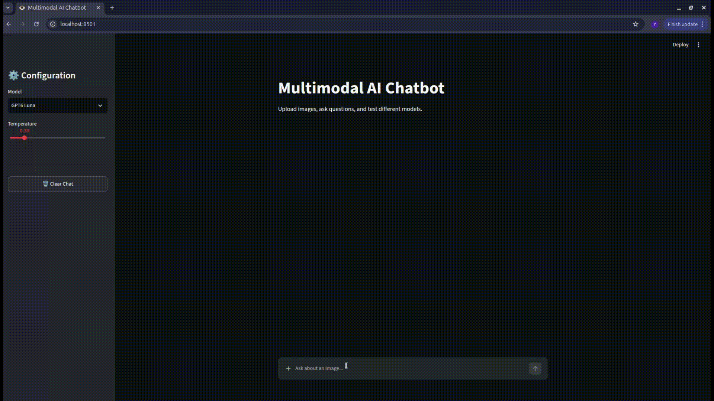

<div align="center">

# 👁️ Multimodal AI Chatbot

**One chat interface, multiple models, and real image understanding, with every response streamed live.**

[](https://www.python.org/)
[](https://streamlit.io/)
[](https://github.com/openai/openai-python)
[](https://python-pillow.org/)
[](LICENSE)



</div>

---

## 📖 Overview

**Multimodal AI Chatbot** is a lightweight Streamlit app for chatting with several LLMs through any OpenAI-compatible API, with first-class support for images.

Attach up to four images to a message, ask a question about them, and switch models from the sidebar mid-conversation. Before anything is sent, every image goes through a hardened processing pipeline (validation, EXIF rotation, transparency flattening, resizing, and compression), so uploads are fast, safe, and consistent across models.

The app is also vision-aware: when you pick a text-only model, file upload is disabled and images are stripped from the context automatically, so you never send a request the model can't handle.

> Built as part of a walkthrough video by **YantraCode** — [watch it here](https://youtu.be/mU9xZE9cabk)

---

## ✨ Features

- 🖼️ **Multi image input**: attach up to 4 images (PNG, JPG, JPEG, WEBP, GIF) per message
- 🔀 **Model Switching**: change models from the sidebar without losing the conversation
- ⚡ **Streaming responses**: tokens appear live as the model generates them
- 🛡️ **Robust image pipeline**: EXIF auto-rotation, transparency flattening, resizing to max 2048px, and JPEG compression before upload
- 🧠 **Sliding context window**: only the last N messages are sent, and the history never begins on an assistant reply
- 🚫 **Vision-aware UI**: file upload is automatically disabled for text-only models
- 🔁 **Safe failure handling**: if an API call fails, the message is not saved to history, so you can simply resend
- 🎛️ **Adjustable temperature**: tune creativity from 0.0 to 2.0 from the sidebar

---

## 🛠️ Tech Stack

| Layer | Technology |
|---|---|
| UI | Streamlit |
| LLM access | OpenAI Python SDK (OpenAI-compatible endpoint) |
| Image processing | Pillow |
| Configuration | python-dotenv |

---

## 📁 Project Structure

```
Multimodal_AI
├── core/
│   ├── image_utils.py          # Image validation, resizing, and base64 encoding
│   └── multimodal_client.py    # Streaming client for the chat completions API
├── assets/
│   └── demo.gif
├── app.py                      # Streamlit UI, chat state, and message building
├── config.py                   # Models, limits, and environment config
├── requirements.txt
├── .gitignore
├── LICENSE
├── .env.example
└── README.md
```

---

## 🚀 Getting Started

### Prerequisites

- Python 3.10+
- An API key for your OpenAI-compatible provider

### Installation

```bash
# Clone the repository
git clone https://github.com/YantraCode-ai/Multimodal_AI.git
cd Multimodal_AI

# Create and activate a virtual environment
python -m venv venv
source venv/bin/activate      # Windows: venv\Scripts\activate

# Install dependencies
pip install -r requirements.txt
```

### Configuration

Create a `.env` file in the project root:

```env
OPENAI_KEY=your_api_key_here
```

> Streamlit **1.43+** is required for file uploads inside `st.chat_input`.

### Running the app

```bash
streamlit run app.py
```

Open the local URL Streamlit prints (typically `http://localhost:8501`), pick a model, and try something like:

> *"Compare these two screenshots and tell me what changed."*

---

## ⚙️ Customization

All settings live in [`config.py`](config.py).

| Setting | Default | Description |
|---|---|---|
| `MAX_IMAGES_PER_MESSAGE` | `4` | Maximum images accepted per message |
| `MAX_HISTORY_MESSAGES` | `20` | Recent messages sent as context |
| `DEFAULT_IMAGE_PROMPT` | `"Analyze this image and explain what you see."` | Used when you send images with no text |

### Adding a model

```python
AVAILABLE_MODELS = {
    "My New Model": {
        "id": "provider/model-id",
        "supports_vision": True,   # False for text-only models
    },
}
```

It appears in the sidebar dropdown automatically.

### Switching API provider

Edit the `base_url` in `core/multimodal_client.py`:

```python
self.client = OpenAI(
    base_url="https://your-provider.com/v1",
    api_key=api_key,
    timeout=60,
)
```

---

## 🗺️ Roadmap

- [ ] Persistent chat history
- [ ] Editable system prompt
- [ ] Per-model parameter presets
- [ ] Export conversation to Markdown
- [ ] Docker support

---

## 🤝 Contributing

Contributions are welcome! Please open an issue to discuss significant changes before submitting a pull request.

1. Fork the repository
2. Create a feature branch (`git checkout -b feature/my-feature`)
3. Commit your changes
4. Open a pull request

---

## 📄 License

Distributed under the MIT License. See [LICENSE](LICENSE) for details.

---

<div align="center">
Built and maintained by <a href="https://github.com/yantracode-ai">YantraCode</a>
<br>Authored By: Akshat Gupta
</div>
